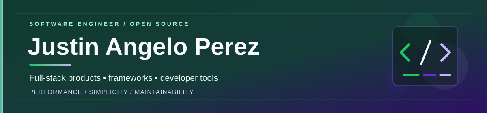

  
  

    
    
    
  

## About me

I build **full-stack web applications** and explore the systems behind them: frameworks, compilers, runtimes, databases, and developer tools.

My strongest foundation is in **PHP/Laravel and JavaScript/TypeScript**. I also build with **C#/.NET and Go**, and use **C++ and Rust** to explore language design, native software, and framework internals.

I value **simple APIs, maintainable architecture, practical performance, and developer experience** more than unnecessary complexity.

## Featured open-source work

### [Gungnir](https://github.com/justinangeloperez327/gungnir) — C++23 web framework + <code>.gnr</code> language

**Current release: v1.0.3** · [Source](https://github.com/justinangeloperez327/gungnir) · [Releases](https://github.com/justinangeloperez327/gungnir/releases) · [Documentation](https://github.com/justinangeloperez327/astro-gungnir) · [Website](https://github.com/justinangeloperez327/next-gungnir)

Gungnir brings familiar web-application conventions to native C++ applications through a structured <code>.gnr</code> language and a compiler/transpiler toolchain. It includes routing, controllers, middleware, authentication, database access, models, migrations, validation, and developer tooling.

<pre><code>controller HomeController {
    Response index() {
        return text("Hello from Gungnir");
    }
}</code></pre>

**Engineering focus:** language frontend and diagnostics · HTTP/runtime design · ORM and persistence · dependency injection · CLI and installation tooling.

## Selected projects

<table>
  <tr>
    <td width="50%" valign="top">
      <h3><a href="https://github.com/justinangeloperez327/berserk">Berserk</a></h3>
      <strong>Rust · Web framework</strong> 
      Framework for APIs and backend services with routing, middleware, validation, authentication, databases, and optional application services. 
      Release: v1.0.0
    </td>
    <td width="50%" valign="top">
      <h3><a href="https://github.com/justinangeloperez327/densleaf">Densleaf</a></h3>
      <strong>Rust · Compiler engineering</strong> 
      Experimental application language with its own <code>.dl</code> grammar, lexer, parser, AST, and Rust code-generation direction. 
      Status: experimental compiler foundation
    </td>
  </tr>
  <tr>
    <td width="50%" valign="top">
      <h3><a href="https://github.com/justinangeloperez327/dot-net-construction-management">Construction Management</a></h3>
      <strong>.NET 10 · Blazor · SQL Server</strong> 
      Construction operations platform organized with Clean Architecture, covering projects, site reporting, document controls, approvals, and deployment workflows.
    </td>
    <td width="50%" valign="top">
      <h3><a href="https://github.com/justinangeloperez327/next-project-tracker-giffin">Project Tracker</a></h3>
      <strong>Next.js · TypeScript · Prisma · PostgreSQL</strong> 
      Project register and progress tracker with substation installation milestones, flexible door types, and bus-shelter progress recording.
    </td>
  </tr>
  <tr>
    <td width="50%" valign="top">
      <h3><a href="https://github.com/justinangeloperez327/go-restaurant">Go Restaurant</a></h3>
      <strong>Go · Chi · PostgreSQL · Next.js</strong> 
      Restaurant ordering platform development, including OAuth, role-based administration, menus, carts, and checkout flows.
    </td>
    <td width="50%" valign="top">
      <h3><a href="https://github.com/justinangeloperez327/next-kanban">Next Kanban</a></h3>
      <strong>Next.js · Socket.IO · Prisma · PostgreSQL</strong> 
      Collaborative task board exploring real-time synchronization, optimistic updates, conflict detection, idempotency, and event replay.
    </td>
  </tr>
</table>

### Also building

- **[Go Budget Tracker](https://github.com/justinangeloperez327/golang-budget-tracker)** — Go, templ, HTMX, and PostgreSQL; multi-currency financial records and dashboards.
- **[Next NBA](https://github.com/justinangeloperez327/next-nba)** — Basketball scoreboard UI with provider adapters, caching, and API quota safeguards.
- **[Next News](https://github.com/justinangeloperez327/next-news)** — Editorial-style Next.js interface; currently uses clearly labeled demonstration content.
- **[Stars Align](https://github.com/justinangeloperez327/next-stars-align)** — Full-stack job platform built with Next.js. [Application](https://stars-align.vercel.app/)

## Technical toolkit

**Languages**

  
  
  
  
  
  
  
  

**Application development**

  
  
  
  
  
  

**Data and engineering**

  
  
  
  
  
  

## What I'm exploring

- **Framework and language design** — expressive APIs, lexers, parsers, ASTs, compiler diagnostics, and code generation.
- **Backend architecture** — modular systems, dependency injection, data modeling, security, and asynchronous workloads.
- **Product engineering** — practical full-stack applications, accessibility, tests, CI, and deployment workflows.

> Build powerful tools without making them difficult to understand.

## Let's connect

I'm open to conversations and collaboration around **backend development, open source, compilers, and developer tooling**.

**[GitHub](https://github.com/justinangeloperez327)** · **[LinkedIn](https://www.linkedin.com/in/justrax/)** · **[Email](mailto:justinangeloperez327@gmail.com)**

Build deliberately. Keep learning. Ship useful software.

